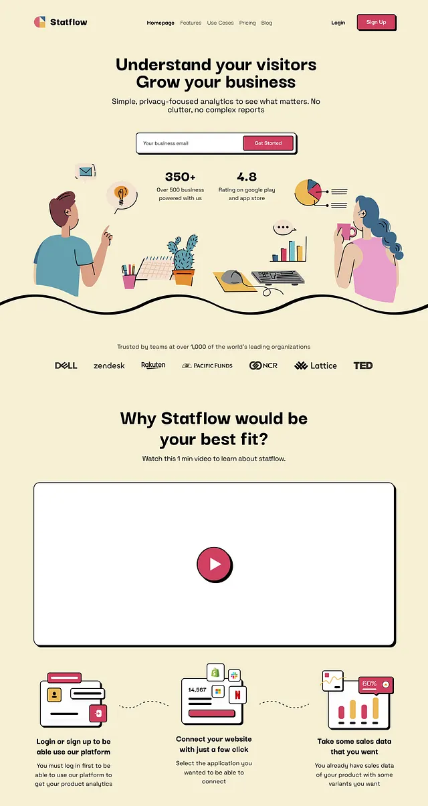

# Cream analytics page with flat character illustration, thick black outlines and raspberry buttons

**Discipline:** web · **Design type:** SaaS landing page
**Tags:** saas, cream, illustration, neo-brutalism, raspberry, hard-shadow, flat, icons

## What it is
A cream page with a nav, a bold centred headline 'Understand your visitors Grow your business', an email field with a raspberry button in a hard-shadow outline, two flat-illustrated characters at desks with a cactus and charts over a wavy black line, logos, a video placeholder with hard shadow, and three step illustrations.

## What it means
Friendly and quirky; flat drawings and hard shadows make analytics approachable.

## Techniques
- Outline every element in thick black with a hard offset shadow.
- Draw flat characters in muted colours.
- Divide sections with a wavy black line.
- Use raspberry as the single accent.

## Best for
- Friendly SaaS and analytics tools
- Illustration-led landing pages
- Neo-brutalist light pages

## Vocabulary
- **Hard offset shadow** — A solid unblurred shadow.
- **Flat illustration** — Drawings with flat colour and simple shapes.
- **Wavy divider** — A curved line separating sections.
- **Accent button** — A button in the single accent colour.
