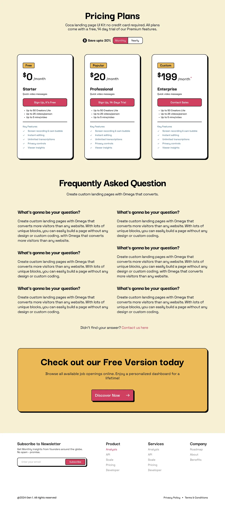

# Butter-cream pricing, FAQ and CTA sections with black-outlined hard-shadow cards, yellow tags and raspberry buttons

**Discipline:** web · **Design type:** Landing page sections
**Tags:** pricing, faq, cream, neo-brutalism, raspberry, yellow, hard-shadow, footer

## What it is
A butter-cream page with a bold 'Pricing Plans' heading and a raspberry monthly-yearly toggle, three white cards with thick outlines and hard shadows each with a yellow tag (Free, Popular, Custom), big prices, raspberry buttons and feature lists, a two-column FAQ with bold questions, a big yellow outlined CTA card with a raspberry button and a footer with newsletter and link columns.

## What it means
Friendly and punchy; outlines, shadows and raspberry make forms and prices feel like stickers.

## Techniques
- Give every card a thick outline and hard shadow.
- Use small yellow tags on plans.
- Use raspberry for actions.
- Fill a full-width yellow CTA card.

## Best for
- Neo-brutalist SaaS pricing pages
- FAQ and CTA sections
- Cream and raspberry brands

## Vocabulary
- **Plan tag** — A small yellow label on a plan card.
- **Toggle switch** — A monthly/yearly selector.
- **CTA card** — A large coloured card with one action.
- **Two-column FAQ** — Questions and answers in two columns.
