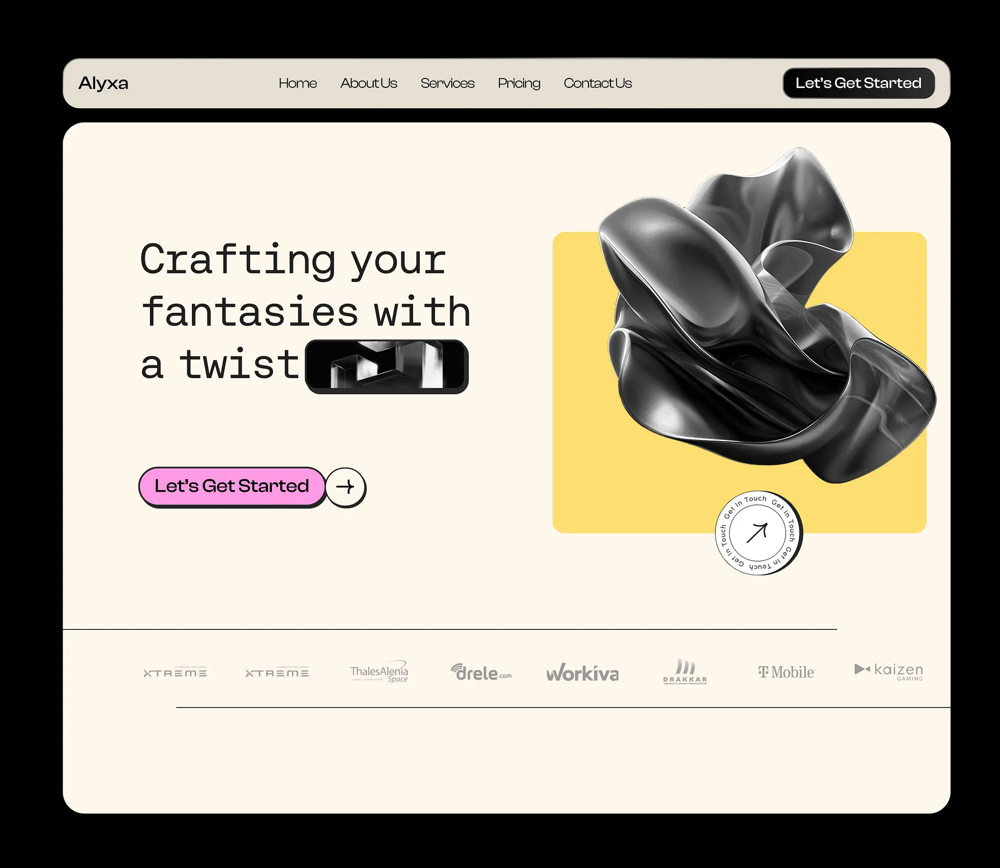

# Cream studio hero with monospace headline, chrome-black 3D fold on yellow and pink button

**Discipline:** web · **Design type:** Landing page hero
**Tags:** hero, cream, yellow, pink, monospace, 3d-object, neo-brutalist-button, logo-strip

## What it is
A black-framed page with a beige rounded nav bar and a cream hero. A monospace headline 'Crafting your fantasies with a twist' has a black pill image inline. A pink pill button with thick outline and arrow circle sits below. On the right a glossy black 3D fold sits on a yellow square with a circular rotating 'Get in touch' badge. A row of grey logos runs below.

## What it means
Playful and tactile; monospace type and chunky buttons feel indie and confident.

## Techniques
- Embed a small image pill inside a headline.
- Use chunky outlined pill buttons with a separate arrow circle.
- Put a dark glossy 3D object on a flat yellow tile.
- Add a circular text badge as a secondary CTA.
- Keep logos in grey below hairlines.

## Best for
- Creative agencies and studios
- Playful landing pages
- Brands mixing 3D objects with flat colour

## Vocabulary
- **Inline image pill** — A tiny picture placed within a line of text.
- **Circular text badge** — Text set around a circle with an icon at centre.
- **Split button** — A pill with an attached arrow circle.
- **Flat colour tile** — A solid rounded block behind a 3D object.
