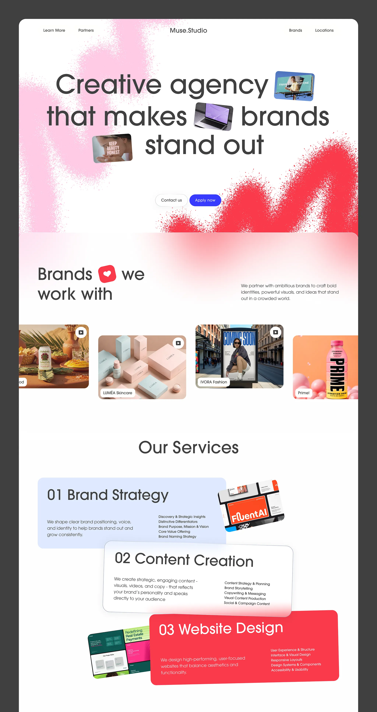

# Agency landing with pink and red spray-paint clouds, inline image chips and stacked service cards

**Discipline:** web · **Design type:** Agency site
**Tags:** agency, spray-texture, pink, red, inline-images, service-cards, light-weight-type, stacked-cards

## What it is
A white page with a tiny nav and a large headline 'Creative agency that makes brands stand out' with tiny tilted image chips inside the text, all over fuzzy pink and red spray blotches. Below are a client carousel with rounded cards, and three overlapping service cards in pale blue, white and red, each with a project image poking out.

## What it means
Bold and warm; spray texture makes a polished page feel handmade.

## Techniques
- Paint spray-grain blotches behind the hero text.
- Embed small tilted image chips in the headline.
- Overlap service cards in different colours like stacked papers.
- Number each service in large light type.

## Best for
- Creative and branding agencies
- Playful service pages
- Portfolio-led landing pages

## Vocabulary
- **Spray blot** — A soft speckled paint shape.
- **Inline image chip** — A small picture inside a headline.
- **Stacked service cards** — Overlapping cards each describing a service.
- **Client carousel** — A horizontal row of client project cards.
