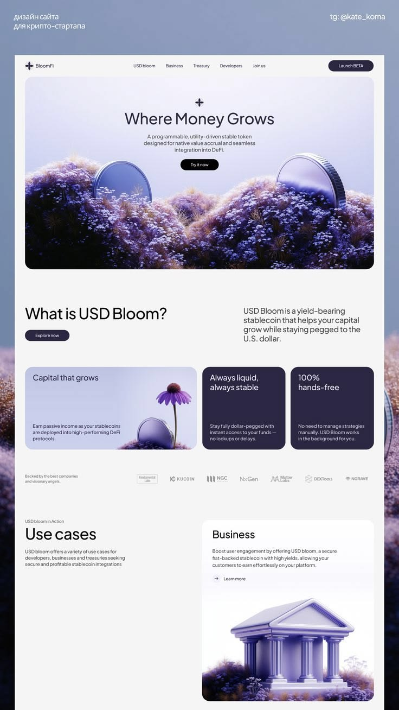

# Stablecoin site with lavender flower-hill hero, giant coins, dark navy cards and a 3D temple

**Discipline:** web ·  · **Design style:** 3D & Surreal
**Tags:** fintech, crypto, lavender, 3d-render, flowers, navy-cards, rounded, light-weight-type

## What it is
A pale grey page with a rounded hero panel: a lilac sky and hills of purple flowers with two huge metallic coins, centred headline 'Where Money Grows' and black button. Below are three cards (one lilac with a coin and coneflower, two dark navy), a logo strip, and a use-cases block with a lilac 3D temple among flowers.

## What it means
Soft, growing and trustworthy; nature imagery makes yield feel organic.

## Techniques
- Render metaphor scenes (coins in flower fields) in one lilac palette.
- Use big rounded image panels inside a neutral page.
- Mix one light card with dark navy cards for contrast.
- Keep type light and centred.

## Best for
- Crypto and DeFi products with a human tone
- Metaphor-driven fintech
- Lavender-branded landing pages

## Vocabulary
- **Metaphor render** — A 3D scene illustrating an idea such as growth.
- **Hero panel** — A rounded image block at the top of the page.
- **Navy card** — A dark blue rounded content card.
- **Use-case block** — A card presenting one application.
