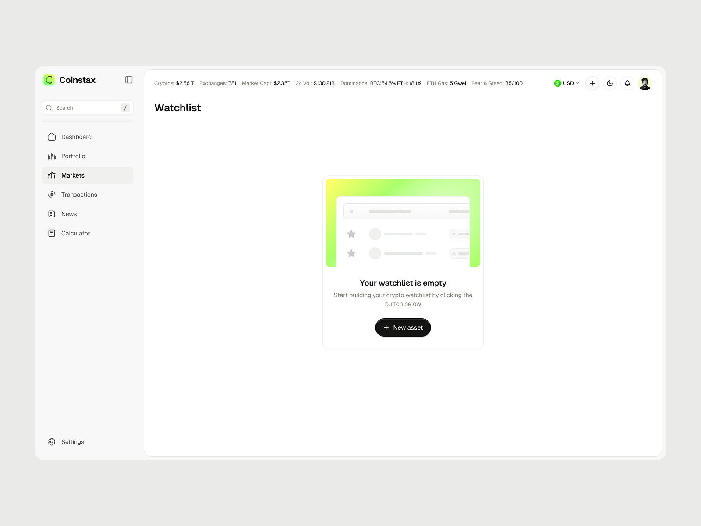

# Empty Watchlist State with Lime Gradient Card

**Discipline:** web ·  · **Design style:** Gradient & Aurora
**Tags:** empty-state, crypto, white, lime, gradient, sidebar, ticker

## What it is
A light dashboard with a sidebar (Markets active), a top ticker of market stats, a Watchlist title and a centred card whose top is a lime gradient with a ghosted list illustration, the text 'Your watchlist is empty', a short explanation and a black New asset pill.

## What it means
A ghosted preview of the list shows what will appear, and one lime gradient plus one black button make the empty state inviting.

## Techniques
- Ghosted illustration of the list as the empty-state art
- Lime gradient behind the illustration
- Single black pill call to action
- Top ticker of market data
- Very sparse layout to keep focus

## Best for
- Empty state design
- Crypto dashboards
- Minimal white UI with a lime accent

## Vocabulary
- **Empty state** — A screen shown when there is no content yet.
- **Ghost preview** — A faint drawing of what content will look like.
- **Ticker bar** — A strip of market figures at the top of a page.
