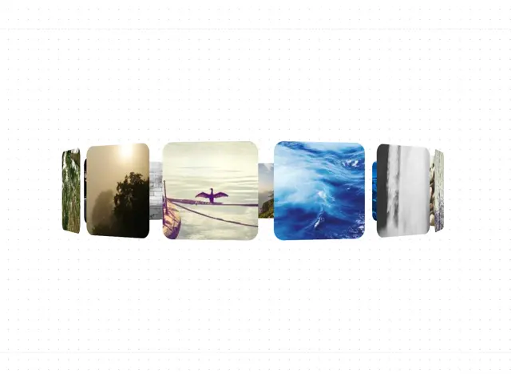

# Ring of rounded photo cards curving around an invisible cylinder, on a dotted white ground

**Discipline:** web ·  · **Design style:** 3D & Surreal
**Tags:** component, carousel, 3d, photo-cards, rounded, dotted, gallery, perspective

## What it is
A horizontal ring of rounded-square nature photos (forest fog, a cormorant on water, blue rapids, a waterfall) that curve away in 3D perspective, the centre cards sharp and the outer ones narrowing, on a faint dotted background.

## What it means
Elegant and tactile; the curve turns a plain gallery into an object you can spin.

## Techniques
- Arrange cards on a circular path in 3D.
- Scale and skew outer cards to imply depth.
- Round every card.
- Keep the background almost empty.

## Best for
- Image galleries and portfolios
- 3D carousel components
- Photography showcases

## Vocabulary
- **3D ring carousel** — Items placed around a cylinder that rotate.
- **Perspective foreshortening** — Items narrowing as they turn away.
- **Rounded photo card** — A photo with softly rounded corners.
- **Dotted ground** — A faint dot grid as background.
