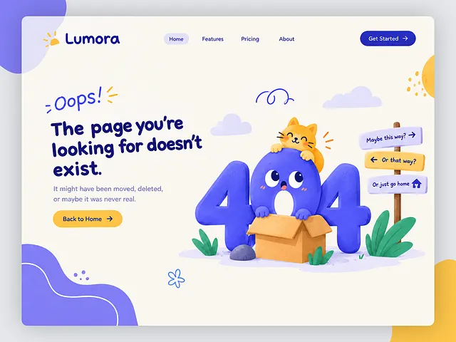

# Cream 404 page with a blue 404 monster in a cardboard box, an orange cat, signpost arrows and a hand-drawn headline

**Discipline:** web · **Design type:** Page section
**Tags:** 404, error-page, illustration, cream, indigo, yellow, cute, character

## What it is
A cream page with a rounded window, blob shapes in the corners, a nav with a Get Started pill and a hand-lettered indigo headline 'The page you're looking for doesn't exist.' with an 'Oops!' scribble, a yellow Back to Home button and a soft illustration of a giant blue 404 with a monster face standing in a cardboard box, an orange cat on top, plants, clouds and a signpost with three yellow and lilac arrows.

## What it means
Friendly and playful; an error becomes a little story with characters and choices.

## Techniques
- Turn the 404 numerals into a character.
- Add a signpost with humorous directions.
- Use a hand-written headline.
- Keep a small palette of indigo, yellow and cream.

## Best for
- Friendly SaaS and consumer sites
- Illustrated error pages
- Character-led brand moments

## Vocabulary
- **Character numerals** — Numbers drawn as a creature.
- **Signpost gag** — A sign with jokey direction options.
- **Hand-lettered headline** — A headline drawn in a casual handwritten style.
- **Blob corner** — Organic shapes tucked into corners.
