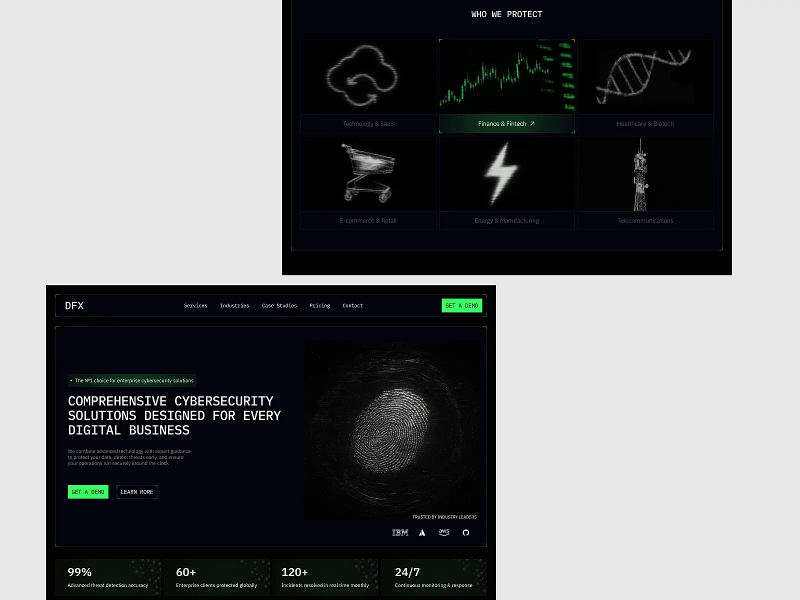

# Cybersecurity site in monospace with neon green accents and glitchy scanned imagery

**Discipline:** web ·  · **Design style:** Dark & Neon
**Tags:** cybersecurity, dark, neon-green, monospace, fingerprint, glitch, bordered-frames, stats

## What it is
Two dark desktop screens with thin framed sections. The hero has monospace uppercase headline, a green 'Get a demo' button, a large glitchy white fingerprint image, partner logos and four stat cells. A second view, 'Who we protect', is a grid of scanline-like icons of cloud, chart, DNA, cart, bolt and tower with green highlight on hover.

## What it means
Technical, secure and slightly hacker-ish; scanline imagery feels like surveillance data.

## Techniques
- Use monospace type and thin corner-bracket frames like a terminal.
- Render icons and hero art as noisy scanline halftones.
- Limit colour to black, grey-white and neon green.
- Highlight the active card with a green gradient border.
- Present stats in a row of dark cells.

## Best for
- Cybersecurity and infrastructure products
- Developer-facing brands
- Dark, technical identities

## Vocabulary
- **Corner brackets** — Small L-shaped marks on the corners of a frame.
- **Scanline imagery** — Graphics made from fine horizontal noisy lines.
- **Monospace UI** — Interface type where every letter has equal width.
- **Hover highlight** — A card given accent colour when active.
