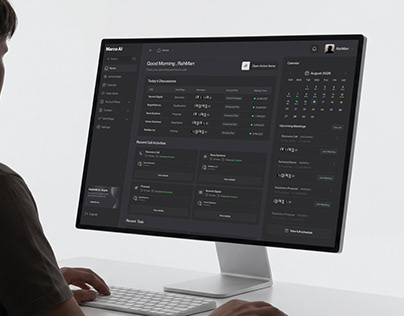

# Dark AI Dashboard on Monitor at a Desk

**Discipline:** web ·  · **Design style:** Dark & Neon
**Tags:** dark-ui, monitor, desk, person, calendar, ai, minimal-room

## What it is
A cover showing a person at a white desk with a keyboard and a large monitor displaying a dark AI meeting dashboard with a calendar and task tables, against a pale wall.

## What it means
A bright real desk scene makes a dark interface feel grounded, and the contrast makes the screen pop.

## Techniques
- Dark UI on a light neutral scene
- Person's shoulder in the frame for context
- Minimal white desk and keyboard
- Screen slightly angled for depth
- Very little colour outside the screen

## Best for
- Dark dashboard covers
- B2B and AI tools
- Contextual desk mockups

## Vocabulary
- **Contextual mockup** — A screen shown in a realistic work setting.
- **Dark on light** — A dark UI placed in a bright room for contrast.
- **Minimal scene** — A staged setting with very few props.
