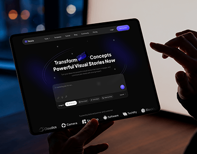

# Dark AI Site on a Tablet

**Discipline:** web ·  · **Design style:** Dark & Neon
**Tags:** tablet, dark, purple, ai, hands, bokeh, cover

## What it is
A tablet held in a dim room showing a dark AI generator website with a purple button, prompt box and partner logos, with hands reaching in and blurred lights behind.

## What it means
The dark room and glowing screen feel like late-night creative work.

## Techniques
- Dark UI in a dark room so the screen glows
- Bokeh city lights in the background
- Hands touching the screen for interaction
- Purple accent on the CTA
- Large centred headline

## Best for
- AI and creative tool sites
- Dark landing page mockups
- Lifestyle-context device shots

## Vocabulary
- **Bokeh** — Soft out-of-focus lights in a photo background.
- **Prompt box** — A large input for typing an AI request.
- **Glow screen** — A display lighting its surroundings.
