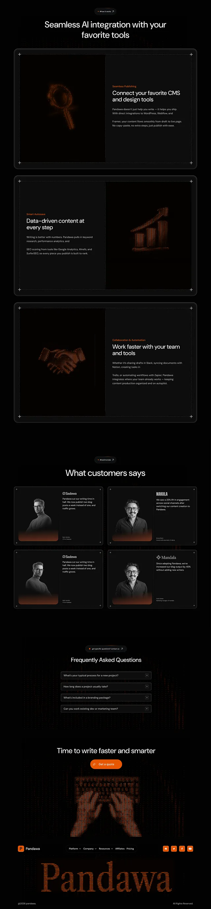

# Long black page with orange dotted ASCII glyph art, framed feature cards and greyscale testimonials

**Discipline:** web · **Design type:** SaaS landing page
**Tags:** saas, dark, orange, ascii-art, corner-marks, testimonials, faq, giant-wordmark

## What it is
A very tall black page: centred headings, three wide framed cards with corner plus marks where an orange dotted icon (magnifier, bar chart, handshake) faces a text block, a testimonial grid with greyscale portraits fading into orange, an FAQ, a dotted hands-on-keyboard graphic and a footer with a giant orange dotted 'Pandawa'.

## What it means
Technical and warm; dotted orange art gives an engraved, data feel.

## Techniques
- Render icons as orange dot-matrix art.
- Frame cards with corner plus marks.
- Fade greyscale portraits into an orange glow.
- End with a huge dotted wordmark.

## Best for
- AI and content tools
- Dark technical sites
- Dot-art identities

## Vocabulary
- **Dot-matrix art** — Images built from a grid of dots.
- **Corner marks** — Plus signs at frame corners.
- **Glow fade** — A photo fading into a coloured glow.
- **Dotted wordmark** — A logo built from dots.
