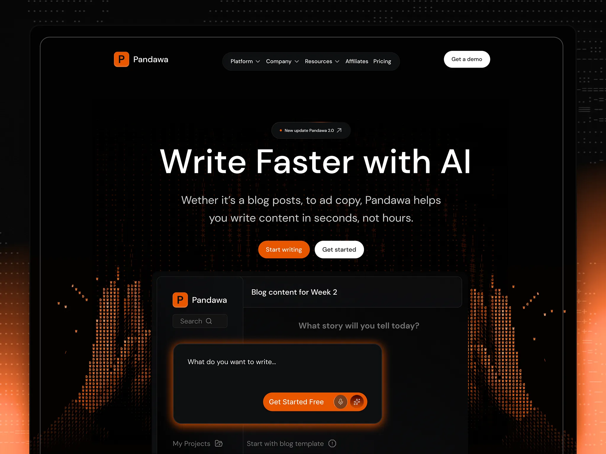

# Dark AI writing hero with orange glow and ASCII flames

**Discipline:** web ·  · **Design style:** Gradient & Aurora
**Tags:** ai, dark-mode, orange, ascii-art, glow, hero, saas, prompt-box

## What it is
A black landing hero with a floating pill nav, a small 'new update' chip, an enormous white headline 'Write Faster with AI', two buttons (orange and white), and an app window with a glowing orange prompt box. Orange glow and ASCII-character flames rise from the bottom edges.

## What it means
Powerful and techy but warm; the orange heat suggests speed and creation.

## Techniques
- Draw texture with letters (ASCII) to make edge glows feel like fire.
- Use one hot orange for glow, primary button and logo on pure black.
- Center a giant sans headline with generous space.
- Give the input box an orange halo so it becomes the hero of the UI.

## Best for
- AI and creative tools
- Dev and productivity SaaS
- Launch pages with a bold dark aesthetic

## Vocabulary
- **ASCII texture** — Imagery made from typed characters.
- **Glow halo** — A soft coloured light around an element.
- **Update chip** — A small pill announcing a release.
- **Floating nav** — A navigation bar as a detached rounded pill.
