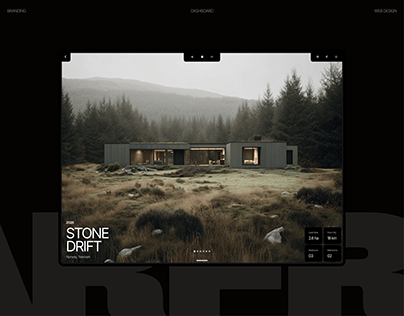

# Moody architecture site with a framed landscape hero and giant cropped background title

**Discipline:** web ·  · **Design style:** Minimalist
**Tags:** architecture, dark, landscape-photo, framed-hero, giant-cropped-type, minimal, stats-card

## What it is
A black cover with tiny top labels, a framed browser-like hero showing a dark cabin in misty moorland with 'STONE DRIFT' in white and a small stats card at the bottom right, and an enormous dark-grey cropped word behind the frame.

## What it means
Quiet and cinematic; the frame and desaturated photo feel like a high-end property film.

## Techniques
- Frame the hero as a screen within a black page.
- Set a giant near-black word behind the frame so it barely shows.
- Use desaturated landscape photography with tiny type.
- Add slide dots at the bottom edge.

## Best for
- Architecture, resort and premium property sites
- Photo-led hero sections
- Dark minimal portfolios

## Vocabulary
- **Framed hero** — A hero image inset in a frame within the page.
- **Background giant word** — Huge low-contrast type behind the main content.
- **Slide dots** — Small dots showing carousel position.
- **Desaturated photo** — An image with muted colour.
