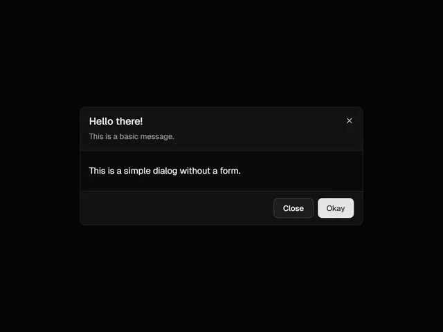

# Dark modal 'Hello there!' with a close icon, hairline sections and Close and Okay buttons on black

**Discipline:** web · **Design type:** UI components
**Tags:** component, dialog, modal, dark, buttons, hairline, minimal, ui-kit

## What it is
A black screen with a dark grey rounded dialog: a header with a bold title, a grey subline and an x, a hairline, a body sentence, a hairline and a footer with a dark Close button and a light Okay button.

## What it means
Quiet and orderly; hairlines and tonal buttons keep a dialog light on dark.

## Techniques
- Divide header, body and footer with hairlines.
- Use a light primary against dark secondary.
- Round the corners.
- Keep copy short.

## Best for
- Dark UI dialog components
- Confirmation modals
- Design-system dialogs

## Vocabulary
- **Dialog** — A modal window with a message and actions.
- **Footer actions** — Buttons aligned at the bottom right.
- **Hairline section** — A thin line separating dialog parts.
- **Tonal button pair** — A dark and a light button side by side.
