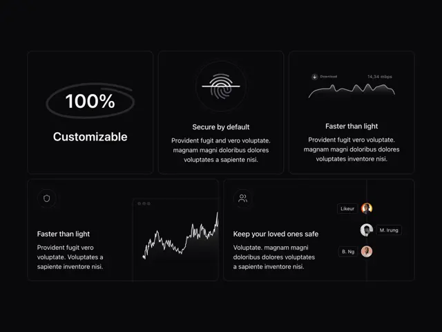

# Five dark bordered feature cards: '100% Customizable' with an oval scribble, a fingerprint, a speed waveform, a growth chart and an avatar list

**Discipline:** web ·  · **Design style:** Playful & Illustrated
**Tags:** saas, dark, bento, hand-drawn-oval, fingerprint, waveform, chart, avatars

## What it is
A black page with a bento of hairline-bordered cards: '100% Customizable' inside a scribbled white oval, a fingerprint icon in a circle with 'Secure by default', a download speed waveform with 'Faster than light', a wide card with a rising jagged white line chart in a mini window, and a card with floating name tags and avatars for 'Keep your loved ones safe'.

## What it means
Minimal and technical; thin lines and small illustrations feel like a modern dev-tool.

## Techniques
- Border cards with hairlines on black.
- Circle a key number with a scribbled oval.
- Illustrate each feature with a tiny graphic.
- Use short bold titles.

## Best for
- Dark SaaS feature bento
- Developer-tool sites
- Minimal illustrated cards

## Vocabulary
- **Hairline card** — A card with a thin subtle border.
- **Scribbled oval** — A hand-drawn ring around a word.
- **Mini window chart** — A chart inside a tiny browser frame.
- **Feature graphic** — A small image explaining one feature.
