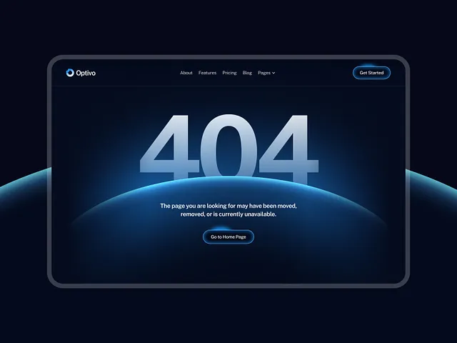

# Dark navy 404 page with silver numerals rising from a glowing blue planet horizon in a rounded frame

**Discipline:** web ·  · **Design style:** Gradient & Aurora
**Tags:** 404, error-page, dark, blue-glow, planet, glass-button, rounded-frame, saas

## What it is
A dark navy canvas with a thick rounded screen frame containing a thin nav, giant pale silver '404' half hidden behind a glowing blue planet curve, a centred explanation and a glowing outlined 'Go to Home Page' pill.

## What it means
Calm and cosmic; the planet horizon turns an error into a scene.

## Techniques
- Use a glowing arc as a horizon behind big numerals.
- Fade numerals into the glow.
- Outline the button with a soft blue halo.
- Frame the page in a rounded bezel.

## Best for
- Tech and SaaS error pages
- Space-themed dark UI
- Glow-based hero art

## Vocabulary
- **Planet horizon** — A glowing curved edge suggesting a planet.
- **Fade numerals** — Numbers dissolving into light.
- **Halo button** — A button with a soft glow outline.
- **Bezel frame** — A thick rounded border around a screen.
