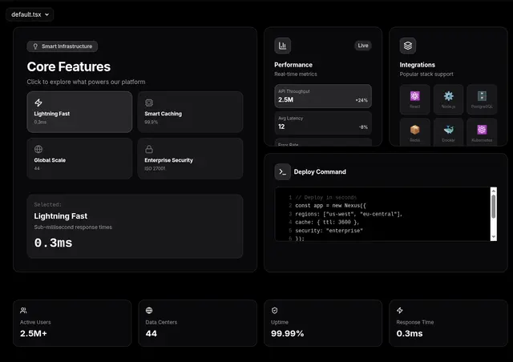

# Black bento 'Core Features' with four selectable tiles and a selected readout, live performance metrics, integrations, a deploy code block and a stats row

**Discipline:** web · **Design type:** Landing page sections
**Tags:** saas, dark, bento, code-block, metrics, selectable, integrations, stats

## What it is
A black dashboard with a file tab, a large card with a small badge, 'Core Features' and a 2x2 of tiles (Lightning Fast, Smart Caching, Global Scale, Enterprise Security) where one is highlighted and its detail '0.3ms' appears in a Selected box; a Performance card with Live tag and metric rows; an Integrations card with framework icon tiles; a Deploy Command card with a scrolling code block; and a bottom row of four stat cards.

## What it means
Technical and interactive; selectable tiles and real code show a product working.

## Techniques
- Let tiles act as selectors for a detail readout.
- Show real code in a card.
- Use small stat cards with icons.
- Keep all cards dark with hairline borders.

## Best for
- Developer and infrastructure marketing
- Interactive bento demos
- Dark technical dashboards

## Vocabulary
- **Selectable tile** — A tile that updates a detail area when chosen.
- **Code card** — A card containing a syntax-style code block.
- **Stat card** — A small card with an icon, label and value.
- **Live tag** — A pill showing real-time data.
