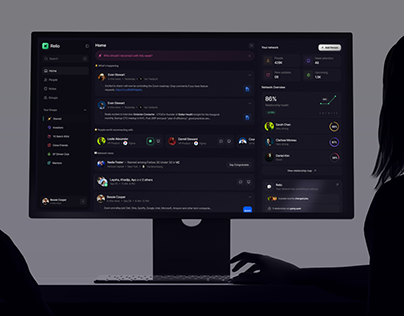

# Dark CRM Dashboard Cover with Silhouette

**Discipline:** web ·  · **Design style:** Minimalist
**Tags:** dark, dashboard, monitor, silhouette, crm, cover, minimal

## What it is
A cover with a desktop monitor showing a dark relationship-management dashboard, a person's silhouette at the right and dark grey shading around.

## What it means
The dark room and lit screen create a focused, professional mood, as if seen at night. The silhouette adds human context.

## Techniques
- Lit screen as the only bright object in a dark scene
- Human silhouette at the frame edge for scale
- Monochrome scene with a tiny green accent
- Cool grey vignette
- Simple central composition

## Best for
- Dark-mode SaaS covers
- B2B dashboards
- Project thumbnails

## Vocabulary
- **Lit screen** — A display glowing in an otherwise dark composition.
- **Silhouette** — A figure shown only as a dark outline.
- **Vignette** — Edges darkened to focus the centre.
