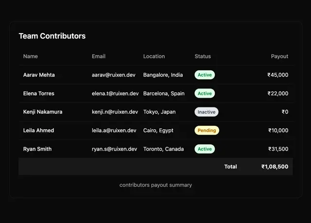

# Dark bordered card table 'Team Contributors' with name, email, location, status pills and payout, and a total row

**Discipline:** web · **Design type:** UI components
**Tags:** component, table, dark, status-pills, green, yellow, total-row, data

## What it is
A black rounded card with a bold title, grey column headers, five rows separated by hairlines with names in bold, emails, locations, status pills (green Active, grey Inactive, yellow Pending) and right-aligned rupee payouts, a slightly lighter Total row and a centred grey caption.

## What it means
Clear and calm; small tonal pills make status readable without heavy colour.

## Techniques
- Use tonal status pills.
- Right-align numeric columns.
- Separate rows with hairlines.
- Add a tinted total row.

## Best for
- Admin tables and dashboards
- Dark data tables
- Payout and contributor lists

## Vocabulary
- **Status pill** — A small coloured capsule showing state.
- **Total row** — A summary row with a slightly different tone.
- **Right-aligned figures** — Numbers aligned to the right edge.
- **Table caption** — A small line describing the table.
