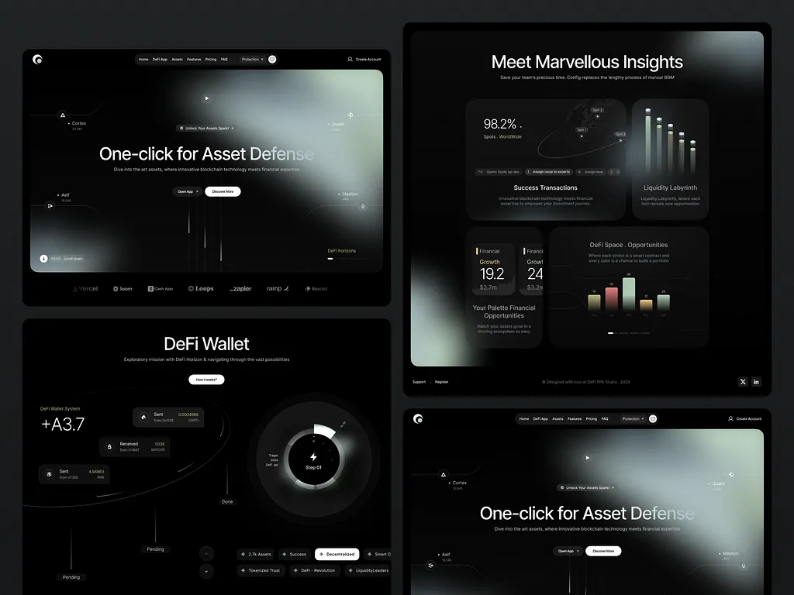

# Black DeFi site with a sage-grey blurred glow, thin white 'One-click for Asset Defense', orbit wallet diagram and bar-chart cards

**Discipline:** web · **Design type:** SaaS landing page
**Tags:** defi, dark, sage-glow, blur, glass-cards, bar-chart, logo-strip, orbit

## What it is
A board of four dark screens: a hero with a huge blurred sage-grey light shape behind a thin white headline and small floating labels, a black 'Meet Marvellous Insights' page with rounded glass cards (98.2% orbit diagram, bar chart, growth stats), a 'DeFi Wallet' page with a circular dial and transaction chips, and a repeated hero.

## What it means
Moody and ethereal; blurred grey-green light gives a technical product a soft mystery.

## Techniques
- Use big blurred light shapes as hero art.
- Set thin white headlines on black.
- Present data on dark glass cards with soft bars.
- Add orbit and dial diagrams.

## Best for
- Crypto and DeFi sites
- Dark ambient heroes
- Glass data cards

## Vocabulary
- **Ambient blur** — Large blurred light shapes as a background.
- **Orbit diagram** — A globe with an elliptical path and nodes.
- **Dial control** — A circular step selector.
- **Glass data card** — A dark translucent card holding a chart.
