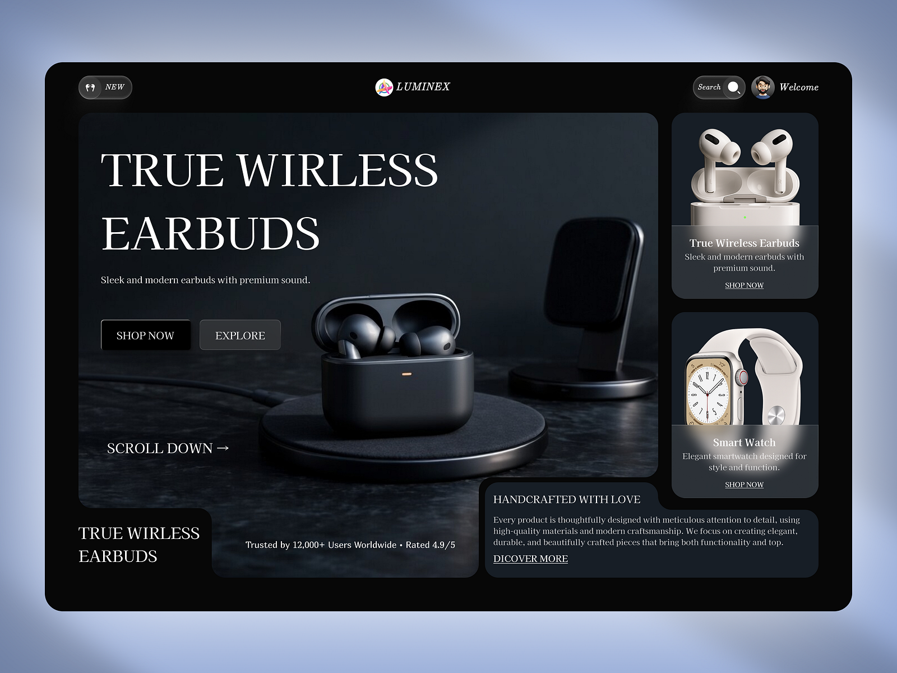

# Dark Serif Earbuds Store Bento Hero

**Discipline:** web ·  · **Design style:** Editorial
**Tags:** dark, serif, bento, earbuds, product, glass-nav, premium

## What it is
A black rounded page on a periwinkle backdrop with a floating pill nav, a large hero tile of black earbuds on a wireless charger with a white serif headline 'TRUE WIRLESS EARBUDS' and two buttons, side product cards for earbuds and a watch with frosted captions, and text tiles for the brand story.

## What it means
A serif on black feels luxurious and editorial, and the bento tiles present products like gallery pieces.

## Techniques
- Large serif caps headline on a dark photo
- Bento of a big hero tile and smaller product tiles
- Frosted caption panels over product images
- Rounded notch in tiles for the text card
- Pill nav with search and avatar

## Best for
- Premium tech and audio brands
- Editorial e-commerce
- Dark product bento layouts

## Vocabulary
- **Bento hero** — A hero built from a large tile beside smaller tiles.
- **Frosted caption** — A blurred translucent panel carrying a product label.
- **Notched tile** — A tile with a cut-out for an adjoining tile.
