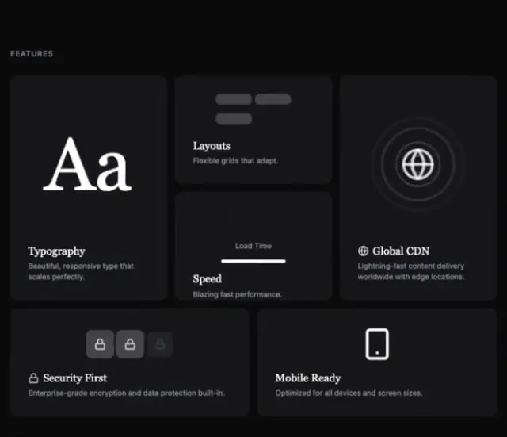

# Black FEATURES bento: a serif Aa card, layouts bars, a globe with rings, a speed line, security locks and a mobile outline

**Discipline:** web · **Design type:** Landing page sections
**Tags:** features, bento, dark, serif, globe, icons, minimal, cards

## What it is
A near-black page with a small caps 'FEATURES' label and rounded dark cards: a tall Typography card with a big white serif 'Aa', a Layouts card with three grey bars, a Global CDN card with a globe icon and concentric rings, a Speed card with a 'Load Time' bar, a wide Security First card with three lock tiles and a Mobile Ready card with a phone outline, each with a bold title and grey description.

## What it means
Minimal and demonstrative; each feature is shown by one tiny graphic.

## Techniques
- Show each feature as one simple graphic.
- Use dark cards without borders.
- Mix tall and wide cards.
- Keep titles white and text grey.

## Best for
- Dark SaaS feature bento
- Developer templates
- Minimal feature illustrations

## Vocabulary
- **Feature graphic** — A tiny illustration of one capability.
- **Dark bento** — A grid of dark rounded cards.
- **Concentric rings** — Circles radiating around an icon.
- **Specimen card** — A card showing a type sample.
