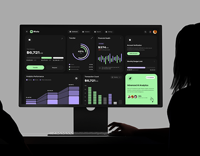

# Dark Fintech Dashboard between Silhouettes

**Discipline:** web · **Design type:** Device mockup scene
**Tags:** monitor, dashboard, dark, silhouettes, lime, lilac, charts

## What it is
A grey studio scene with a monitor showing a black finance dashboard with lime and lilac widgets, framed by the silhouettes of two people at left and right and a hand on the keyboard.

## What it means
Silhouettes frame the monitor like an audience, and the bright widgets glow against the dark.

## Techniques
- Dark silhouettes framing the subject
- Lime and lilac accents on a dark UI
- Monitor centred in a grey studio
- Small keyboard hand for scale
- Bento widgets of different chart types

## Best for
- Dark dashboard covers
- Fintech case studies
- Framed monitor presentations

## Vocabulary
- **Framing silhouettes** — Dark shapes at the frame edges that direct focus to the centre.
- **Bento widget** — A dashboard tile with one visual.
- **Studio grey** — A neutral grey backdrop used in product staging.
