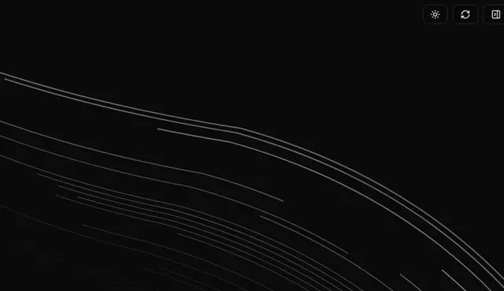

# Black field of thin grey flow lines sweeping from left to lower right, with three small icon buttons at the top right

**Discipline:** web · **Design type:** Background pattern
**Tags:** background, lines, dark, generative, flow-field, minimal, theme-toggle, abstract

## What it is
A near-black canvas with many fine grey curved lines sweeping across like long-exposure star trails, and three small bordered icon buttons (theme, refresh, panel) at the top right.

## What it means
Calm and generative; thin lines suggest movement and depth.

## Techniques
- Draw many thin lines following one flow.
- Vary line length and brightness.
- Keep only grey on black.
- Add tiny control buttons.

## Best for
- Dark hero backgrounds
- Generative art backdrops
- Minimal tech pages

## Vocabulary
- **Flow field** — Lines following a common direction.
- **Star-trail lines** — Long thin arcs like a long exposure.
- **Generative background** — An image produced by rules or code.
- **Icon button** — A small square button with an icon.
