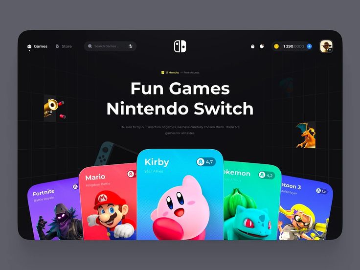

# Dark Game Store with Fanned Cards

**Discipline:** web · **Design type:** Landing page hero
**Tags:** games, dark, fan-cards, colourful, hero, store, 3d-grid

## What it is
A dark game-store hero in a rounded frame with a centred headline, floating 3D icons on a perspective grid, and a fan of tall coloured game cards (purple, red, blue, green, yellow) with character art and ratings at the base.

## What it means
Saturated cards against black feel exciting, and the fan shape pulls the eye toward the centre card.

## Techniques
- Fan of tall cards in different hues
- Perspective grid lines on black
- Floating 3D icons around the headline
- Central card enlarged and lifted
- Compact nav with currency and avatar

## Best for
- Game stores and libraries
- Dark entertainment sites
- Hero sections with card carousels

## Vocabulary
- **Card fan** — Cards arranged in an arc, overlapping at the base.
- **Perspective grid** — Receding grid lines giving depth to a background.
- **Rating chip** — A small pill showing a score on a card.
