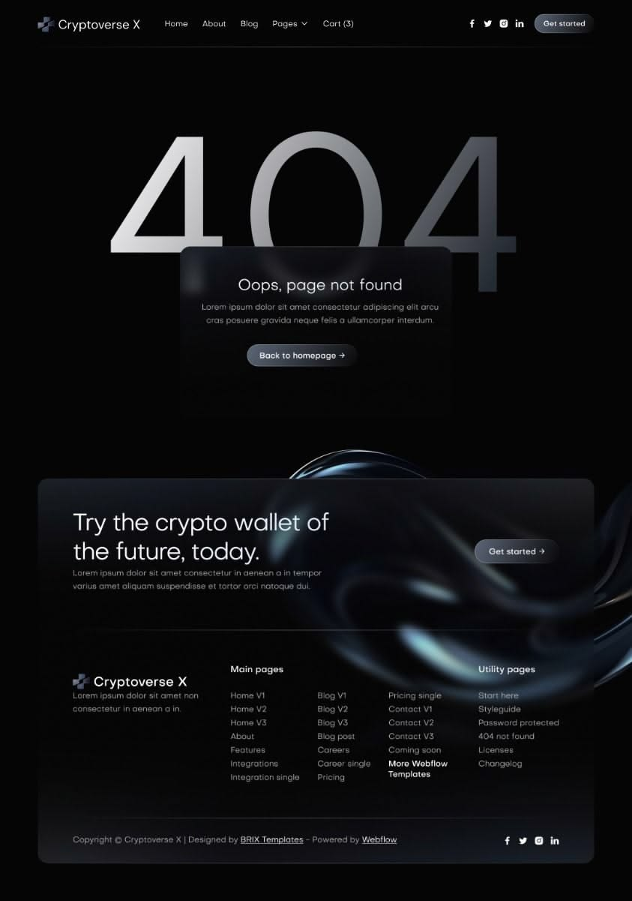

# Black 404 in silver-gradient numerals behind a frosted card, plus a glass CTA and footer with a chrome swirl

**Discipline:** web · **Design type:** Page section
**Tags:** 404, error-page, dark, chrome, glass, crypto, footer, gradient-numerals

## What it is
A pure black page with a thin nav, giant thin '404' fading from silver to dark, a frosted glass card 'Oops, page not found' with a glass button, below a wide glass CTA panel 'Try the crypto wallet of the future, today.' with a blue-chrome swirl rising through it and a multi-column footer.

## What it means
Sleek and premium; glass and chrome make even an error page feel expensive.

## Techniques
- Use thin numerals with a metallic gradient.
- Overlay a frosted card on the numerals.
- Run a chrome swirl across CTA and footer.
- Keep everything black, grey and blue.

## Best for
- Crypto and fintech templates
- Dark premium error pages
- Glassmorphic footers

## Vocabulary
- **Metallic gradient** — A silver-like blend across text.
- **Chrome swirl** — A glossy 3D ribbon graphic.
- **Glass button** — A translucent button with a subtle sheen.
- **Overlay card** — A card laid over large numerals.
