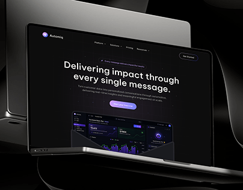

# Dark Laptop with Purple Marketing UI

**Discipline:** web · **Design type:** Device mockup scene
**Tags:** laptop, dark, purple, black-glass, hero, dashboard, cover

## What it is
A cover with a laptop showing a dark website hero ('Delivering impact through every single message') with a purple button and analytics preview, framed by dark glossy black curved sculptural shapes.

## What it means
Sculptural black glass behind the laptop feels premium and futuristic, letting the purple accent glow.

## Techniques
- Glossy black abstract forms as a backdrop
- Dark UI on a dark scene for a unified mood
- Purple as the only accent
- Laptop angled slightly for depth
- Large centred headline in white

## Best for
- SaaS and marketing-automation sites
- Dark premium web mockups
- Case-study covers

## Vocabulary
- **Sculptural backdrop** — Abstract 3D shapes used as a stage.
- **Dark-on-dark** — UI and scene both in dark tones.
- **Glow accent** — A small bright colour standing out on black.
