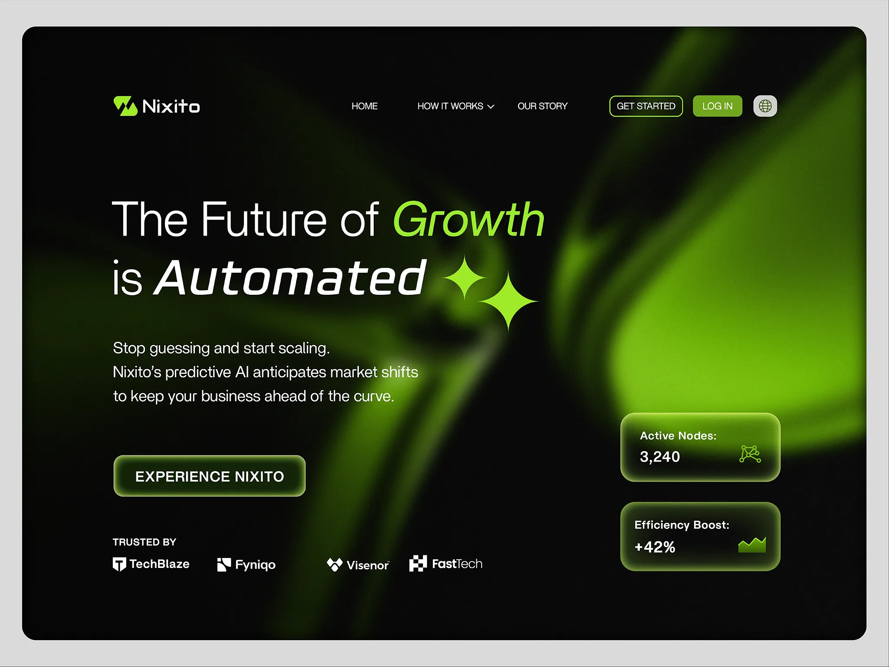

# Black hero with blurred lime-green light, italic emphasis words, sparkles and glass stat cards

**Discipline:** web ·  · **Design style:** Glassmorphism
**Tags:** saas, ai, dark, lime-green, blur, italic, sparkle, glass-cards

## What it is
A rounded black hero with big blurred green light shapes, a pill nav with outlined and green buttons, a headline 'The Future of Growth is Automated' with italic lime and white emphasis words and two sparkles, a glowing outlined CTA, a logo row and two glass cards (Active Nodes, Efficiency Boost) on the right.

## What it means
Futuristic and energetic; blurred light gives an AI product an organic glow.

## Techniques
- Use out-of-focus green light as the hero art.
- Italicise key words in the headline.
- Add sparkle glyphs beside the text.
- Show small glass stat cards with mini icons.

## Best for
- AI and automation SaaS
- Dark green or lime brands
- Blur-glow heroes

## Vocabulary
- **Blur glow** — A large blurred coloured light.
- **Emphasis italics** — Key words in italic and accent colour.
- **Glass stat card** — A translucent card with a metric.
- **Glow CTA** — A button with a soft luminous border.
