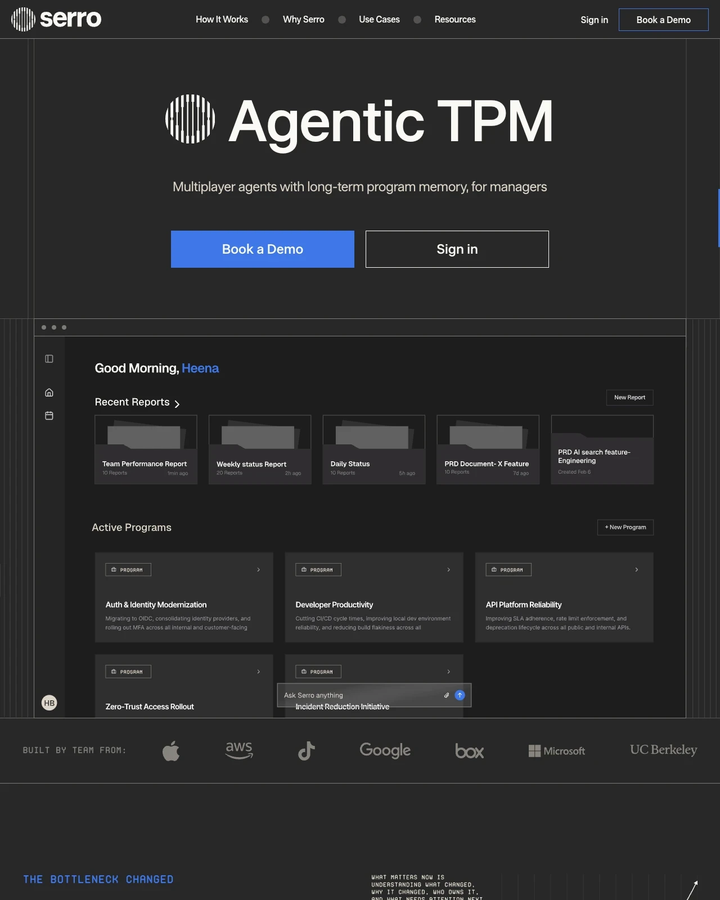

# Dark Blueprint Landing with Dashboard Preview

**Discipline:** web · **Design type:** SaaS landing page
**Tags:** dark, grid-lines, blueprint, monospace, dashboard, enterprise, striped-logo

## What it is
A dark charcoal landing page with a large striped-circle logo beside the headline 'Agentic TPM', outlined and solid blue buttons, thin vertical guide lines framing the page, a dashboard preview inside a window frame and mono-type labels.

## What it means
Hairline rules and monospace labels give a technical, engineered feel, like a blueprint, while the single blue accent stays confident and focused.

## Techniques
- Visible hairline column guides framing the content
- Blue filled CTA next to an outlined ghost CTA
- Monospace uppercase labels for a technical voice
- Dashboard shown in a window frame that is cut off at the bottom
- Logo strip labeled 'Built by team from' for credibility

## Best for
- Developer and enterprise tools
- B2B software with a serious tone
- Products for technical managers

## Vocabulary
- **Guide lines** — Visible thin lines that expose the layout grid as decoration.
- **Ghost button** — A button with only an outline and no fill.
- **Mono label** — Small uppercase monospace text used as a technical caption.
