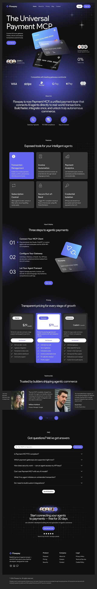

# Dark indigo landing page for an AI payment product with floating cards

**Discipline:** web ·  · **Design style:** Dark & Neon
**Tags:** saas, dark-mode, indigo, payment, 3d-cards, pricing, faq, long-scroll

## What it is
A full-length dark landing page with a big headline and a hero of two tilted 3D payment cards, logo strip, feature cards in a 3x2 grid with one highlighted in indigo, a numbered three-step section with a plug graphic, a three-tier pricing table with the middle plan in bright indigo, testimonials, FAQ accordion and final CTA.

## What it means
Technical and trustworthy in a nighttime palette; indigo glow shows the featured item in each section.

## Techniques
- Highlight one card in each group with the brand indigo.
- Use a radial glow behind each section to break the black.
- Present steps with giant thin numerals.
- Make the middle pricing card the brightest.
- Use tilted 3D objects as hero art.

## Best for
- Developer tools and AI infrastructure
- Fintech and payment APIs
- Subscription SaaS with tiered pricing

## Vocabulary
- **Featured card** — The one card in a group given the accent colour.
- **Radial glow** — A soft circular light behind a section.
- **Pricing tiers** — Side-by-side plans with the recommended one emphasised.
- **FAQ accordion** — Expandable question rows.
