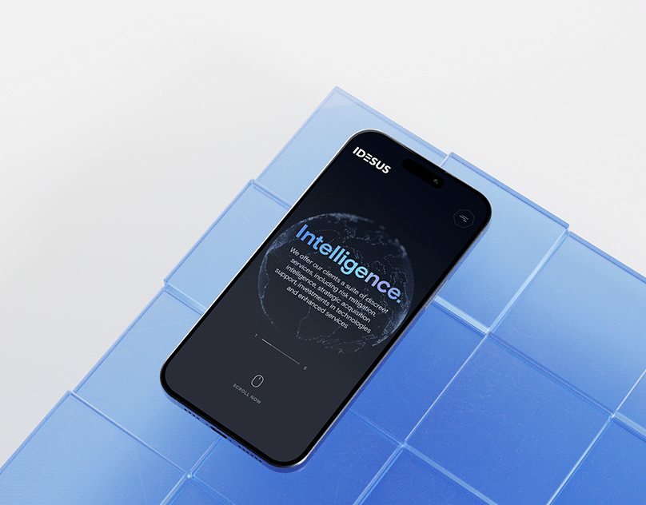

# Dark mobile site with a glowing dotted globe and blue gradient 'Intelligence.' on a phone lying on blue glass blocks

**Discipline:** web ·  · **Design style:** Glassmorphism
**Tags:** mobile-web, dark, globe, blue, glass-blocks, gradient-type, phone, consulting

## What it is
A phone lies on translucent blue glass cubes against a pale background showing a dark page with a small logo, a dotted glowing globe and a big blue-gradient word 'Intelligence.' with a paragraph and a scroll-now mouse icon.

## What it means
Secretive and global; a dark globe screen on bright glass gives cool contrast.

## Techniques
- Place a dark UI on bright glass blocks.
- Use a dotted globe as hero art.
- Fill a heading with a blue gradient.
- Add a scroll cue.

## Best for
- Intelligence and consulting sites
- Dark mobile heroes
- Glass-block mockups

## Vocabulary
- **Dotted globe** — A globe drawn with dots.
- **Gradient heading** — A heading filled with a colour gradient.
- **Glass blocks** — Translucent cubes used as a stage.
- **Scroll cue** — An icon inviting scrolling.
