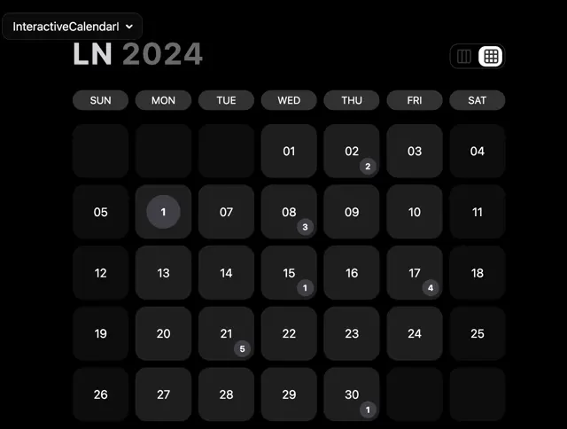

# Dark month calendar with rounded date tiles, round count badges, weekday pills, a two-tone year title and a view toggle

**Discipline:** web ·  · **Design style:** Geometric & Bauhaus
**Tags:** component, calendar, dark, tiles, badges, weekday-pills, toggle, grid

## What it is
A black interface with a small dropdown label, a heading 'LN 2024' in white and grey, a segmented toggle between columns and grid views, a row of grey weekday pills and a grid of dark rounded date tiles where some carry small grey circular badges with counts and one date (1) is highlighted in a lighter circle.

## What it means
Sleek and tactile; soft tiles and tiny badges turn a calendar into a set of pressable cards.

## Techniques
- Render days as soft rounded tiles.
- Show event counts as small round badges.
- Use pills for weekday headings.
- Keep to greys on black.

## Best for
- Calendar and scheduling components
- Dark UI kits
- Tile-based grids

## Vocabulary
- **Date tile** — A rounded square representing one day.
- **Count badge** — A small circle showing the number of events.
- **Weekday pill** — A capsule labelling a column.
- **View toggle** — A control switching between layouts.
