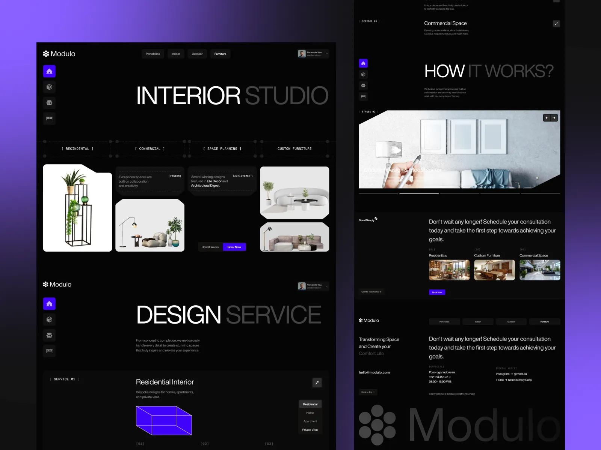

# Dark interior-design site in black with violet buttons, half-grey giant headlines and bracket labels

**Discipline:** web · **Design type:** Portfolio site
**Tags:** interior, dark, violet, monospace, bracket-labels, cutout-furniture, grid-lines, long-scroll

## What it is
Two dark page columns on a violet-to-black backdrop: a left icon rail, giant 'INTERIOR STUDIO' where the second word is grey, bracketed monospace labels on a dotted line, white furniture cutouts in notched tiles, a violet 3D box wireframe for services, a slideshow, and a large faded 'Modulo' logo in the footer.

## What it means
Technical and elegant; brackets and dotted grids feel like blueprints for interiors.

## Techniques
- Set the headline half white half grey.
- Label sections with bracketed monospace tags.
- Use notched cutout tiles for products.
- Use violet only for actions.

## Best for
- Interior and architecture studios
- Dark blueprint-style sites
- Furniture showcases

## Vocabulary
- **Bracket label** — A monospace tag inside square brackets.
- **Notched tile** — A tile with a cut corner.
- **Two-tone headline** — A headline half bright, half dimmed.
- **Icon rail** — A vertical strip of square icon buttons.
