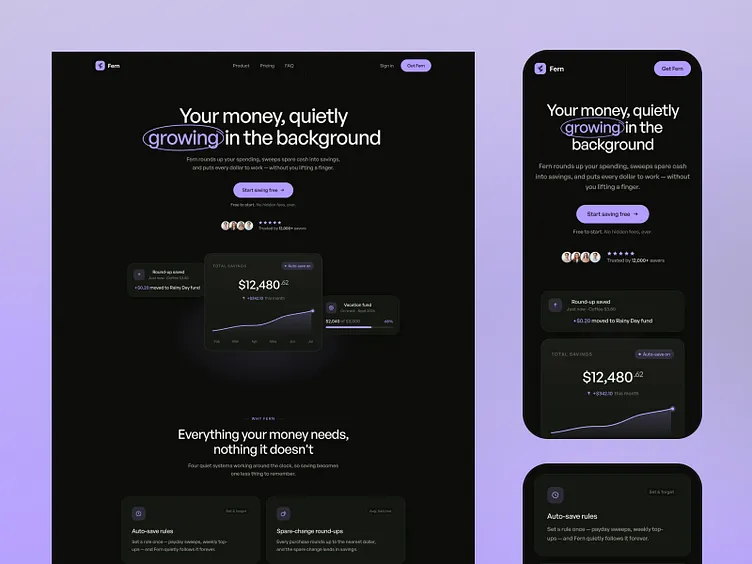

# Black savings-app page on a lavender field with a hand-drawn ring around 'growing', floating chart cards and a mobile version

**Discipline:** web · **Design type:** SaaS landing page
**Tags:** fintech, dark, lavender, hand-drawn-ring, chart, floating-cards, mobile, saas

## What it is
A lavender canvas with a black desktop page and a black phone: a pill nav with a lavender button, a headline 'Your money, quietly growing in the background' with an oval outline around 'growing', a lavender CTA, avatars and stars, floating dark cards (round-up saved, total savings with a line chart, vacation fund) and a features section with dark cards.

## What it means
Quiet and trustworthy; dark UI with one lavender accent feels calm and premium.

## Techniques
- Circle one keyword with an oval outline.
- Float dark cards around a chart.
- Use one lavender accent on black.
- Show desktop and mobile together.

## Best for
- Fintech and savings apps
- Dark UI with one accent
- Floating card heroes

## Vocabulary
- **Keyword ring** — An oval outline around a headline word.
- **Floating dark card** — A dark card hovering around a hero chart.
- **Single accent** — One colour used for actions and highlights.
- **Line chart glow** — A soft glow under a chart line.
