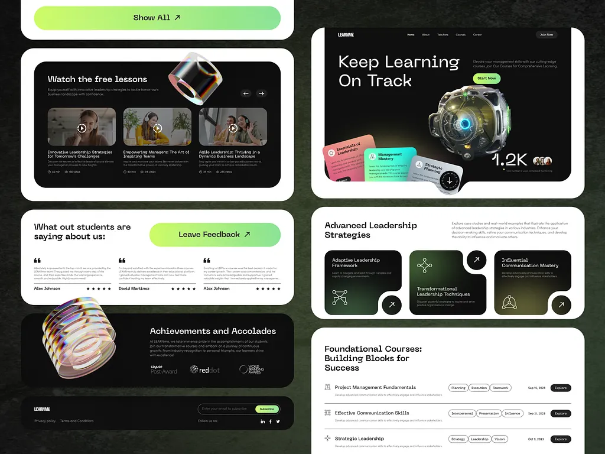

# Dark course platform with lime-to-green gradient buttons, a 3D metal-sphere hero and iridescent glass rings on black cards

**Discipline:** web ·  · **Design style:** Glassmorphism
**Tags:** education, dark, lime, gradient-buttons, 3d-glass, white-frames, courses, bento

## What it is
A green-black textured board with white-framed sections: a black hero 'Keep Learning On Track' with a lime button and a 3D mechanical sphere with floating gradient course cards and a 1.2K counter, black video-lesson cards with a glass ring, a white testimonials block with a lime gradient Leave Feedback button, a black achievements block with an iridescent glass stack and award logos, dark leadership tiles with icons and arrow buttons, and a foundational courses list with tag pills.

## What it means
Modern and premium; glassy 3D objects and lime gradients make learning feel high-tech.

## Techniques
- Use lime-to-green gradient buttons.
- Add iridescent 3D glass objects to dark cards.
- Frame black sections in white rounded frames.
- List courses with hairlines and tag pills.

## Best for
- Online learning platforms
- Dark lime brands
- 3D glass accents

## Vocabulary
- **Gradient button** — A button filled with a colour gradient.
- **Iridescent glass** — A glass object with rainbow reflections.
- **White frame** — A white border around a dark section.
- **Course row** — A list line with tags, date and Explore button.
