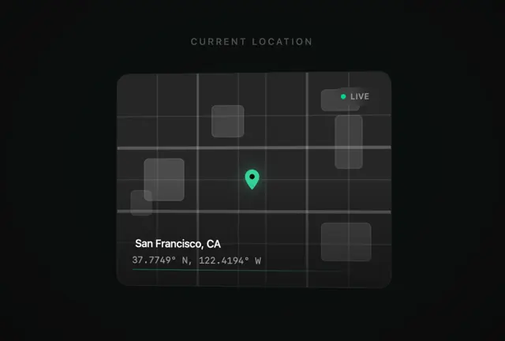

# Frosted dark map card with a line grid, translucent blocks, a mint pin, a LIVE badge and San Francisco coordinates in monospace

**Discipline:** web · **Design type:** UI components
**Tags:** component, map, dark, mint, live-badge, coordinates, glass, monospace

## What it is
A black page with a small caps label 'CURRENT LOCATION' above a translucent rounded card that shows an abstract street grid with frosted rectangles as buildings, a glowing mint location pin at the centre, a 'LIVE' pill with a green dot at the top right and at the bottom 'San Francisco, CA' with monospace coordinates and a thin mint progress line.

## What it means
Precise and modern; an abstract grid map with one mint pin is enough to say 'you are here'.

## Techniques
- Abstract a map into grid lines and frosted blocks.
- Use one bright pin.
- Add a live status pill.
- Show coordinates in monospace.

## Best for
- Location and tracking cards
- Dark glass components
- Minimal map visuals

## Vocabulary
- **Abstract map** — A simplified grid standing in for a map.
- **Live badge** — A pill with a green dot showing real-time status.
- **Coordinates line** — Latitude and longitude in monospace.
- **Frosted block** — A translucent rectangle used as a building.
