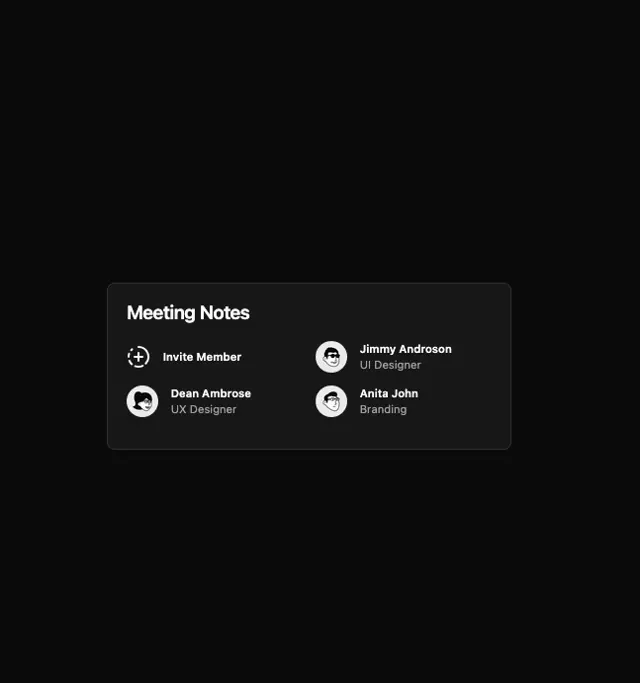

# Small dark 'Meeting Notes' card listing members with cartoon avatars and a dashed-circle Invite Member action

**Discipline:** web · **Design type:** UI components
**Tags:** component, member-list, dark, avatars, invite, cartoon, card, minimal

## What it is
A black page with a small charcoal bordered card titled 'Meeting Notes' holding a two-column list: an 'Invite Member' entry with a dashed circle and plus icon, and three members with black-and-white cartoon face avatars, bold names and grey roles.

## What it means
Compact and friendly; illustrated avatars add character to a utility list.

## Techniques
- Show an add action as a dashed circle.
- Use line-art avatars.
- Bold names over grey roles.
- Contain in a small bordered card.

## Best for
- Member and collaborator lists
- Dark card components
- Invite patterns

## Vocabulary
- **Dashed add button** — A dashed circle with a plus for adding.
- **Line-art avatar** — A cartoon face drawn in outline.
- **Member row** — An avatar with name and role.
- **Compact card** — A small container for a short list.
