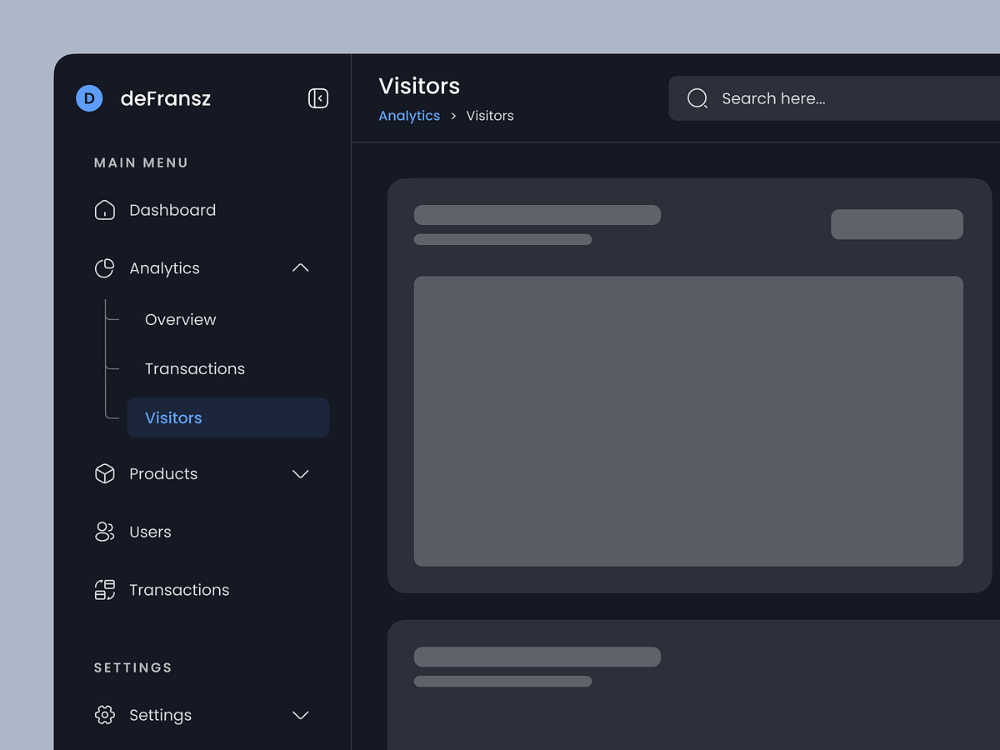

# Dark Analytics Sidebar with Skeleton Content

**Discipline:** web ·  · **Design style:** Corporate & Clean-Tech
**Tags:** sidebar, dark, navy, skeleton, breadcrumb, blue, analytics

## What it is
A cropped dark navy dashboard shell on a grey backdrop showing a sidebar with logo, main menu with an expanded Analytics group and an active Visitors item in blue, a settings group, and a content area with a title, breadcrumb, search field and grey skeleton placeholders.

## What it means
Skeleton blocks let the navigation shell be the focus, and a single blue marks the active item and breadcrumb.

## Techniques
- Skeleton placeholders standing for content
- Blue active item and breadcrumb link
- Tree line for nested items
- Small caps section headings
- Collapse button beside the logo

## Best for
- Dark dashboard shells
- Sidebar navigation showcases
- Layout wireframes with skeletons

## Vocabulary
- **Skeleton screen** — Grey blocks standing in for content that will load.
- **Breadcrumb** — A path showing where the user is in a hierarchy.
- **Dashboard shell** — The sidebar and header frame around content.
