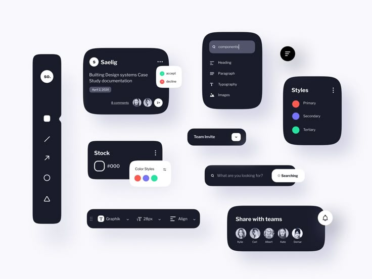

# Dark Design-Tool Panels on White

**Discipline:** web · **Design type:** UI components
**Tags:** dark, panels, design-tool, toolbar, styles, search, components, scattered

## What it is
A white board of scattered dark navy rounded panels forming a design-tool interface: a vertical toolbar with a logo and shape icons, a document card with accept and decline chips, a component search list, a styles panel with coloured dots, a stock panel with a colour popover, a team invite dropdown, a search bar with a white button, a horizontal text toolbar and a share-with-teams panel.

## What it means
Dark panels on a white board with soft shadows look like floating tools, and small coloured dots supply life.

## Techniques
- Dark navy panels floating with soft shadows
- Small coloured dots (red, violet, mint) as palette accents
- White popovers over dark cards
- Scattered layout with varied panel sizes
- Consistent radius and type

## Best for
- Design-tool and editor UI concepts
- Component showcase boards
- Dark-on-white panel systems

## Vocabulary
- **Floating panel** — A UI panel with a shadow appearing to hover.
- **Popover** — A small panel that appears over another element.
- **Toolbar** — A strip of tools arranged in a row or column.
