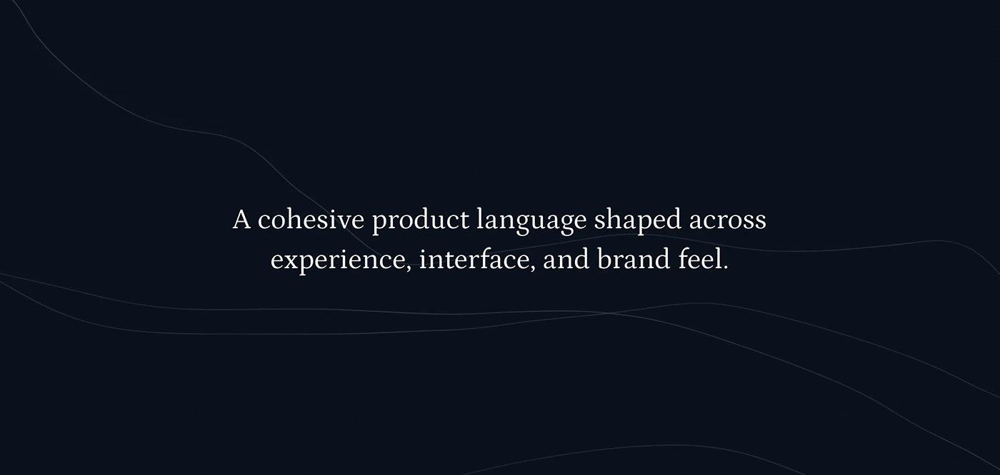

# Dark navy banner with a centred serif sentence over faint wavy contour lines

**Discipline:** web · **Design type:** Closing banner
**Tags:** statement, dark-navy, serif, contour-lines, minimal, centred, transition, mission

## What it is
A wide near-black navy field with a few faint grey wavy lines and a centred two-line white serif statement 'A cohesive product language shaped across experience, interface, and brand feel.'

## What it means
Quiet and thoughtful; a serif sentence on dark gives a reflective pause.

## Techniques
- Use a single serif statement as a section break.
- Add very faint contour lines for texture.
- Keep the palette to navy and white.
- Centre the text with generous space.

## Best for
- Section dividers in case studies
- Mission statements
- Dark, refined presentations

## Vocabulary
- **Statement slide** — A slide with one sentence.
- **Contour lines** — Fine wavy lines suggesting topography.
- **Serif on dark** — Light serif type on a dark field.
- **Breathing space** — Empty room around text.
