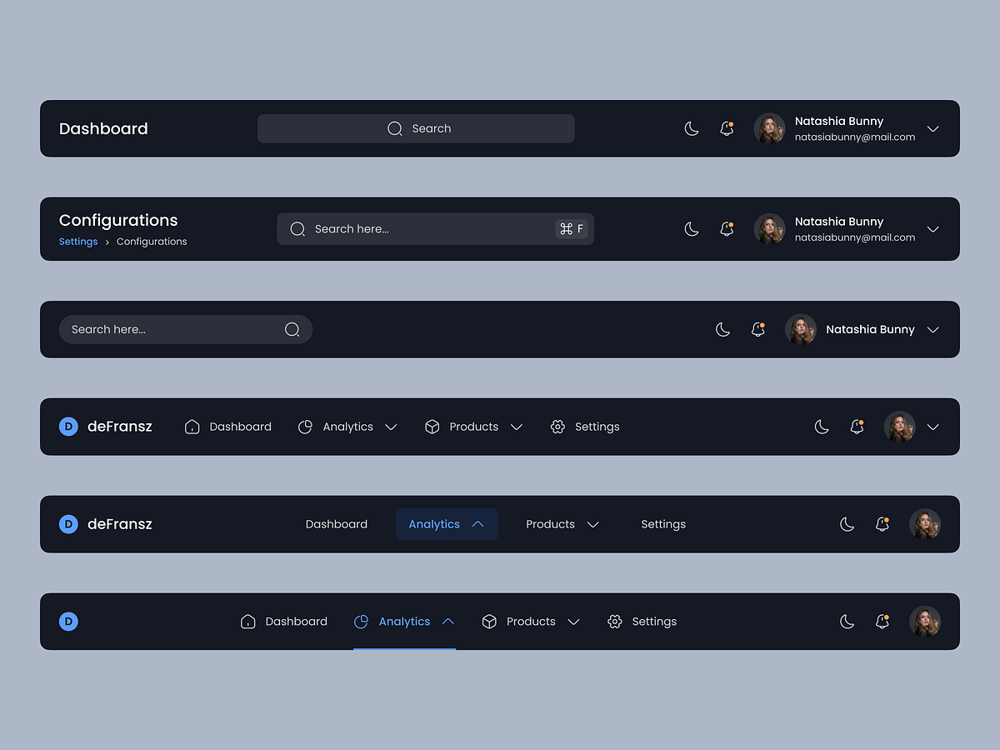

# Dark Navy Top Navigation Bar Variants

**Discipline:** web · **Design type:** UI components
**Tags:** top-bar, navigation, dark, navy, search, profile, blue-active, variants

## What it is
Six dark navy rounded top bars on grey-blue: a simple Dashboard title with search and profile, a title with breadcrumb and shortcut hint, a left search with actions, and three versions with the deFransz logo and text links (Dashboard, Analytics, Products, Settings), the Analytics item highlighted in blue as a pill or underline.

## What it means
Showing several layouts of the same bar documents choices, and a single blue marks active while the rest stay quiet.

## Techniques
- Six arrangements of the same elements
- Blue active state as text, pill or underline
- Notification dot in orange
- Dark mode toggle icon in each bar
- Consistent height and radius

## Best for
- Top navigation bar systems
- Dark dashboards
- Header component documentation

## Vocabulary
- **Header variant** — An alternative arrangement of a page header.
- **Shortcut hint** — A keyboard shortcut shown inside a search field.
- **Notification dot** — A small coloured dot on a bell icon.
