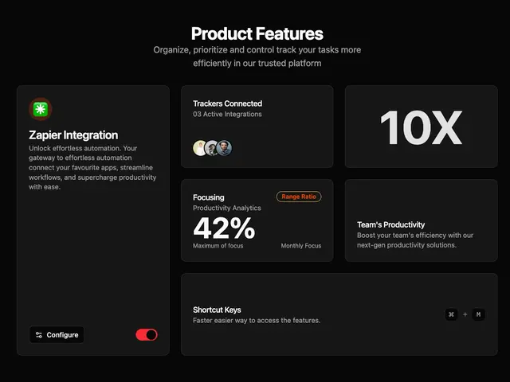

# Black 'Product Features' bento: Zapier integration with a red toggle, connected trackers, a giant 10X, focus analytics with an orange tag and shortcut keys

**Discipline:** web ·  · **Design style:** Corporate & Clean-Tech
**Tags:** saas, dark, bento, toggle, stats, shortcut-keys, orange, cards

## What it is
A near-black page with a centred heading and grey subline above bordered dark cards: a tall Zapier Integration card with an orange-green logo, a description, a Configure button and a red toggle; a 'Trackers Connected' card with avatars; a '10X' card with huge grey numerals; a 'Focusing' card with '42%' and an orange Range Ratio pill; a Team's Productivity card; and a wide Shortcut Keys card with keycaps.

## What it means
Technical and orderly; big numerals and small controls show product depth quickly.

## Techniques
- Use giant numerals as a graphic tile.
- Show real controls (toggle, button) in cards.
- Add one orange tag as an accent.
- Show keyboard shortcuts as keycaps.

## Best for
- Dark SaaS feature bento
- Productivity products
- UI-in-card feature showcases

## Vocabulary
- **Numeral tile** — A card built around a giant number.
- **Keycap** — A small key-shaped label for a shortcut.
- **Toggle in card** — A functional switch shown inside a card.
- **Accent tag** — A single coloured pill in a dark set.
