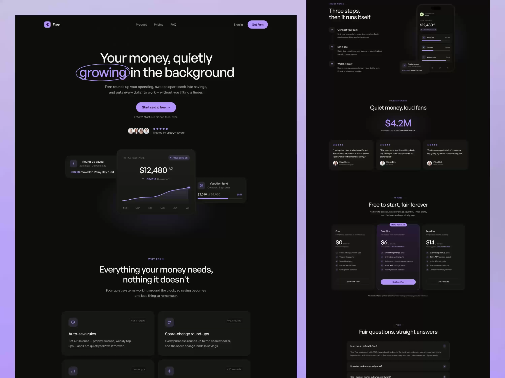

# Dark Violet Savings App Landing Page

**Discipline:** web · **Design type:** SaaS landing page
**Tags:** dark, violet, fintech, glow, cards, pricing, testimonials, lavender-backdrop

## What it is
Two long landing-page screens on a lavender gradient backdrop: near-black pages with a large sans headline where 'growing' is circled in violet, a floating savings-chart card cluster, feature cards, steps, testimonials and three-tier pricing with the middle plan highlighted.

## What it means
Black plus a single soft violet feels premium and calm, matching the 'quietly growing' promise. The hand-drawn circle adds humanity to a very polished page.

## Techniques
- Hand-drawn oval around one headline word
- Floating overlapping cards in the hero showing key numbers
- Highlighted middle pricing tier with a glow and 'Most popular' tag
- Micro uppercase eyebrow labels above each section title
- Presenting the design on a soft gradient backdrop to lift it

## Best for
- Fintech and savings products
- Premium subscription apps
- Portfolio showcases of full pages

## Vocabulary
- **Circled word** — A loose ellipse drawn around one word to emphasize it.
- **Eyebrow** — A small label above a heading that names the section.
- **Featured tier** — A pricing plan visually elevated to steer choice.
