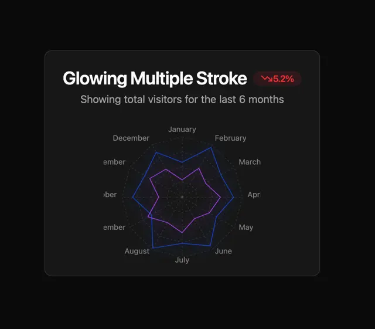

# Dark card 'Glowing Multiple Stroke' with a red -5.2% badge and a radar chart of two glowing polygons over months

**Discipline:** web · **Design type:** Data visualization
**Tags:** chart, radar, dark, blue, violet, glow, badge, card

## What it is
A black rounded card with a bold title, a red pill '-5.2%' with a down arrow, a grey subtitle and a radar chart with dotted grid rings, month labels around the edge and two glowing polygons, one blue and one violet.

## What it means
Technical and elegant; a soft glow makes thin data lines feel luminous.

## Techniques
- Draw multiple series as glowing strokes.
- Use dotted concentric rings.
- Show change in a small red pill.
- Place month labels on the perimeter.

## Best for
- Dark dashboards
- Radar and comparison charts
- Glow-styled data cards

## Vocabulary
- **Radar chart** — A chart plotting values on radial axes.
- **Glow stroke** — A line with a soft luminous halo.
- **Delta pill** — A capsule showing change with an arrow.
- **Perimeter labels** — Labels placed around a circular chart.
