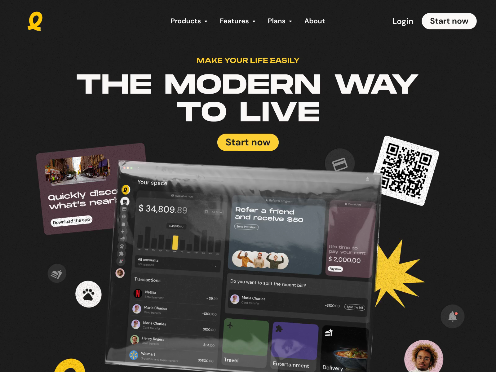

# Dark Fintech Hero with Sticker Collage

**Discipline:** web ·  · **Design style:** Playful & Illustrated
**Tags:** dark, yellow, extended-type, collage, stickers, fintech, tilted, grain

## What it is
A charcoal landing hero with a wide extended-bold white headline 'The Modern Way to Live', a yellow pill CTA, and a tilted translucent dashboard covered in collage elements: a QR sticker, a yellow starburst, round icon chips, photo cutouts and a mauve card.

## What it means
The collage and tilt bring rebellious, zine-like energy to a normally sober fintech, while yellow on charcoal keeps it bold and readable.

## Techniques
- Ultra-wide extended sans in caps for the headline
- Tilted, plastic-wrapped dashboard mockup for texture
- Sticker and cut-out elements layered around the UI
- Yellow as the sole accent against charcoal
- Grain overlay on elements for a printed feel

## Best for
- Youth-focused fintech and lifestyle apps
- Brands that want to feel anti-corporate
- Hero sections that need a maximal, playful look

## Vocabulary
- **Extended type** — A typeface with wide letterforms.
- **Collage layering** — Mixing UI, photos and stickers in overlapping stacks.
- **Tilted mockup** — A screenshot rotated in perspective to add dynamism.
