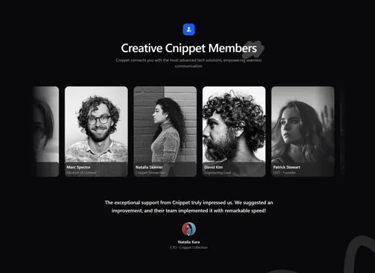

# Black 'Creative Cnippet Members' row of greyscale portraits with name and role overlays and a testimonial below

**Discipline:** web · **Design type:** Page section
**Tags:** team, dark, greyscale, portraits, carousel, overlay, testimonial, blue-icon

## What it is
A black page with a small blue icon tile, a white heading with a brush scribble, a grey line, a horizontal row of tall greyscale portrait cards cropped at the edges with translucent bottom bars carrying names and roles, and below a centred white testimonial with a round avatar, name and role.

## What it means
Editorial and calm; monochrome portraits create a unified team look on black.

## Techniques
- Convert all team portraits to greyscale.
- Put names in a translucent bar on each photo.
- Crop the row at the screen edges.
- Follow with one testimonial.

## Best for
- Team and member sections
- Dark greyscale portrait rows
- Community sites

## Vocabulary
- **Greyscale portrait row** — A row of black-and-white portraits.
- **Caption bar** — A translucent strip over the bottom of a photo.
- **Edge crop** — Items cut by the frame to imply scrolling.
- **Centred testimonial** — A quote with avatar under a section.
