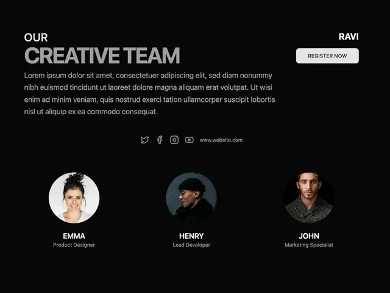

# Dark 'OUR CREATIVE TEAM' heading in white and grey with a paragraph, social icons and three circular portraits with names and roles

**Discipline:** web ·  · **Design style:** Photographic & Cinematic
**Tags:** team, dark, circular-portraits, two-tone-heading, social-icons, minimal, caps, black

## What it is
A black page with a small 'OUR' above a big grey condensed 'CREATIVE TEAM', a grey paragraph, a row of social icons and a URL, a top-right name and light Register button, and three round portraits (a woman, a man in a beanie, a bearded man) with white caps names and grey roles.

## What it means
Minimal and confident; circular portraits and a two-tone heading keep a team section calm.

## Techniques
- Set a two-tone condensed heading.
- Crop portraits into circles.
- Centre names and roles beneath.
- Show social icons in a row.

## Best for
- Team sections on dark sites
- Circular avatar layouts
- Minimal agency pages

## Vocabulary
- **Two-tone heading** — A heading in white and grey parts.
- **Circular portrait** — A photo cropped to a circle.
- **Role caption** — A small line naming a job title.
- **Social row** — A line of small platform icons.
