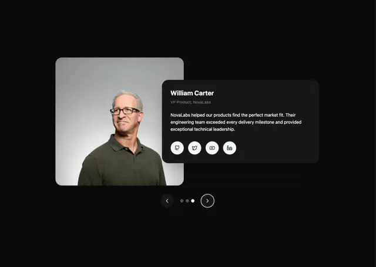

# Dark testimonial slider: rounded grey portrait overlapped by a black card with name, role, quote and four round social buttons, arrows and dots

**Discipline:** web · **Design type:** UI components
**Tags:** component, testimonial, dark, portrait, overlap, social-icons, carousel, dots

## What it is
A black canvas with a large rounded portrait of an older man in glasses and olive polo, overlapped by a dark rounded card with a bold name 'William Carter', a grey role, a paragraph quote and four white round social icon buttons, and below outlined circular arrows with three dots.

## What it means
Credible and modern; overlap ties the face to the words.

## Techniques
- Overlap a text card over a portrait.
- Use white round social buttons.
- Add dot pagination between arrows.
- Keep tones dark.

## Best for
- Dark testimonial carousels
- Team quote components
- Portrait-and-card layouts

## Vocabulary
- **Overlap card** — A card placed partly over an image.
- **Social button** — A round icon button linking to a profile.
- **Pagination dots** — Dots showing the current slide.
- **Outlined arrow** — A circular arrow with a border.
