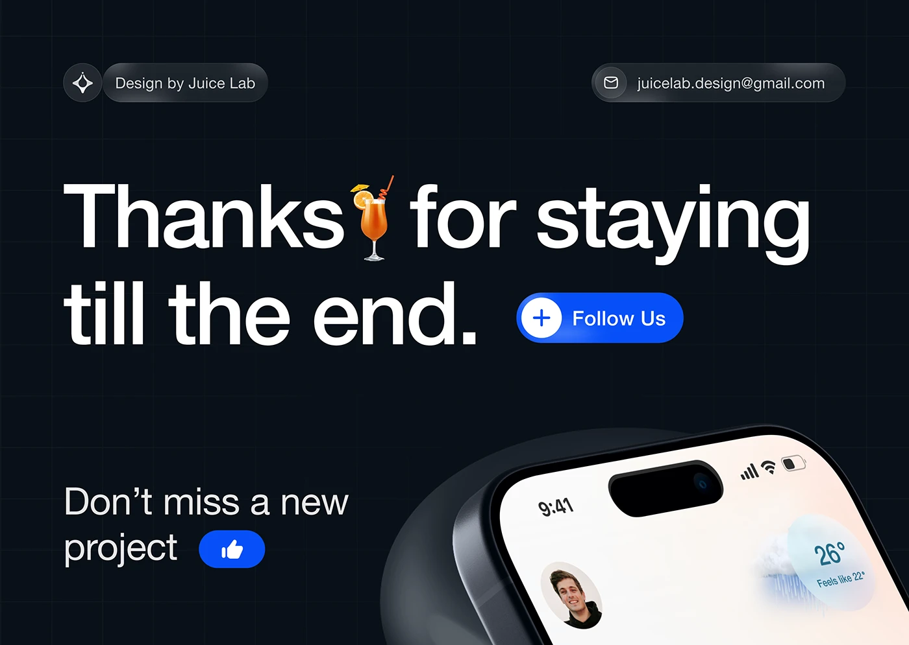

# Dark sign-off with giant white 'Thanks for staying till the end.', glass pills, follow button and a phone corner

**Discipline:** web ·  · **Design style:** Glassmorphism
**Tags:** closing, dark, white-type, glass-pills, follow-button, phone, grid, emoji

## What it is
A near-black slide with a faint grid, glass pills for the studio name and email, a giant white heavy sans headline with a cocktail emoji, a blue Follow Us pill, a smaller 'Don't miss a new project' with a blue thumbs-up and a tilted phone corner with a weather widget.

## What it means
Friendly and social; platform-like buttons and an emoji lighten the sign-off.

## Techniques
- Use giant white headline with an inline emoji.
- Add blue action pills.
- Use glass pills for contact.
- Show a phone corner at the bottom.

## Best for
- Case-study closing slides
- UI portfolio endings
- Dark social sign-offs

## Vocabulary
- **Inline emoji** — An emoji placed within a headline.
- **Glass contact pill** — A translucent capsule with an icon and text.
- **Action pill** — A coloured capsule like Follow Us.
- **Phone corner** — A cropped device in a corner.
